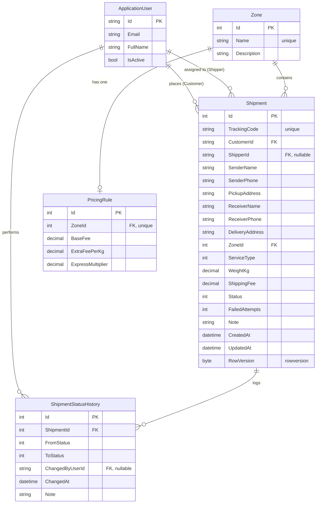

# ShipTrack

**Shipment & Delivery Management System** — an ASP.NET Core **Web API** built with **.NET 10**, **SQL Server** (Docker) and **EF Core Code-First**, plus **ASP.NET Core Identity + JWT** auth. The focus is clean business rules, a layered architecture, and design patterns — built as a portfolio project for a .NET Backend / Fullstack Intern position.

## Features

- Register / log in with JWT (Customers self-register; Dispatcher/Shipper accounts are seeded only).
- Create shipments with an auto-generated tracking code and automatic fee calculation.
- Fee **estimate** endpoint (not persisted) plus automatic fee on creation.
- Public tracking lookup by tracking code with status history (sensitive fields masked).
- Dispatcher assigns Shippers (max 5 active per Shipper, concurrency-safe).
- Shippers update delivery status; every change writes a history row.
- Customers cancel shipments (only when allowed).
- Zone & PricingRule CRUD (R13).
- Dashboard: shipments by status, revenue, delivery success rate, top shippers.
- Paged / filtered / searchable shipment lists.

## Tech stack

| Area | Choice |
|------|--------|
| Runtime / SDK | .NET 10, C# (`Nullable` + `ImplicitUsings`) |
| App type | ASP.NET Core **Web API** (Controllers) |
| Database | SQL Server (Docker) + EF Core Code-First + Migrations |
| Auth | ASP.NET Core Identity + JWT Bearer (60 min, no refresh token) |
| API docs | Swagger (Swashbuckle) |
| Logging | `ILogger` + Serilog (console + file) |
| Validation | DataAnnotations |
| Mapping | Hand-written (no AutoMapper) |
| Testing | xUnit + Moq |
| Frontend | Plain HTML/CSS/JS + Bootstrap 5 (planned) |

## Architecture & design patterns

Layered flow: **Controllers → Services → Domain (entities / enums / rules) → Repositories (EF Core)**.

- **Repository + Unit of Work** — `IZoneRepository`, `IPricingRuleRepository`, `IShipmentRepository`, `IShipperRepository`, `IDashboardRepository` plus an `IUnitOfWork` that wraps `SaveChangesAsync`. Services depend on interfaces for testability.
- **Strategy** — `IShippingFeeCalculator` with `StandardFeeCalculator` (R4) and `ExpressFeeCalculator` (R5); a `ShippingFeeCalculatorFactory` resolves the calculator by `ServiceType`. *Open/Closed:* adding a service type only needs a new calculator + one factory entry.
- **State machine** — `ShipmentStateMachine` holds the valid-transition table as data (R1); `ShipmentStatusService` enforces R1/R11/R12 against it.
- **DTO + hand-written mapping** — entities are never returned from the API.
- **Middleware** — `GlobalExceptionHandler` (`IExceptionHandler`) maps errors to a consistent `ProblemDetails` body; Serilog writes request logs.
- **Dependency Injection** — DbContext/services are Scoped; the stateless fee calculators and their factory are Singletons.

## Project structure

```
ShipTrack/
├─ docs/                       # SPEC, RULES, TASKS, STACK, DATA-MODEL, DECISIONS
├─ src/
│  └─ ShipTrack.Api/
│     ├─ Controllers/          # thin HTTP layer
│     ├─ Services/             # interfaces + implementations (business rules)
│     ├─ Repositories/         # data access (EF Core) + IUnitOfWork
│     ├─ Domain/               # entities, enums, ShipmentStateMachine
│     ├─ Data/                 # DbContext, Fluent configs, Migrations, DbInitializer
│     ├─ Dtos/                 # request/response DTOs
│     └─ Middleware/           # global exception handler
├─ tests/
│  └─ ShipTrack.Tests/         # xUnit + Moq
├─ docker-compose.yml
└─ README.md
```

## Data model (ERD)



## API (prefix `/api`)

| Method | URL | Role | Description |
|--------|-----|------|-------------|
| POST | /auth/register | Public | Register a Customer |
| POST | /auth/login | Public | Returns a JWT |
| GET | /zones | Customer+ | List zones |
| POST/PUT/DELETE | /zones, /zones/{id} | Dispatcher | Zone CRUD |
| GET/POST/PUT | /pricing-rules, /pricing-rules/{id} | Dispatcher | Manage pricing rules |
| POST | /shipments/estimate | Customer | Estimate fee (R3–R5) |
| POST | /shipments | Customer | Create shipment (R6, R12) |
| GET | /shipments/my | Customer | My shipments (paged, filtered) |
| GET | /shipments | Dispatcher | All shipments (paged, filtered, searchable) |
| GET | /shipments/{id} | Owner/Dispatcher/assigned Shipper | Details + history |
| POST | /shipments/{id}/cancel | Customer/Dispatcher | Cancel shipment (R2) |
| POST | /shipments/{id}/assign | Dispatcher | Body `shipperId` (R7, R8, R9) |
| POST | /shipments/{id}/status | Shipper | Body `newStatus`, `note` (R10) |
| GET | /shippers/my-tasks | Shipper | Shipments assigned to me |
| GET | /shippers | Dispatcher | Shippers with active counts |
| GET | /tracking/{code} | Public | Tracking lookup (R15) |
| GET | /dashboard/summary | Dispatcher | Statistics |

Errors always return a consistent `ProblemDetails` body from the global exception handler.

## Business rules (R1–R15)

| # | Rule |
|---|------|
| R1 | A status change is valid only per the lifecycle table; violations return `409`. |
| R2 | A shipment can be cancelled only in `Created`/`Assigned`; only the owner (or a Dispatcher) may cancel. |
| R3 | Weight must be `> 0` and `≤ 30` kg. |
| R4 | Fee = `BaseFee + ceil(max(0, weight − 1)) × ExtraFeePerKg` (the first kg is included in `BaseFee`). |
| R5 | `Standard` = R4 formula; `Express` = Standard fee × `ExpressMultiplier` (one `PricingRule` per Zone). |
| R6 | Tracking code is unique, `ST` + `yyyyMMdd` + 6 random uppercase alphanumerics; lookup is case-insensitive. |
| R7 | Each shipper may have at most 5 active shipments (Assigned/PickedUp/InTransit); exceeding returns `409`. |
| R8 | A shipper can be assigned only while the shipment is `Created`; the shipper must be `IsActive`. |
| R9 | Concurrent assignment — only one succeeds, the other gets `409` (via `RowVersion`). |
| R10 | A shipper may update only shipments assigned to them. |
| R11 | At most 3 `DeliveryFailed` events; the 3rd automatically moves the shipment to `Returned`. |
| R12 | Every status change writes a `ShipmentStatusHistory` row; history is never edited or deleted. |
| R13 | `Zone.Name` is unique; `PricingRule.ZoneId` is unique; a Zone with shipments cannot be deleted. |
| R14 | Email unique on registration; password ≥ 6 characters. |
| R15 | Public tracking returns only status, history, and a partially masked receiver name. |

## Getting started

### Prerequisites
- [.NET 10 SDK](https://dotnet.microsoft.com/download/dotnet/10.0)
- [Docker](https://www.docker.com/) (for SQL Server)

### Run it

1. **Clone**
   ```bash
   git clone https://github.com/<your-username>/ShipTrack.git
   cd ShipTrack
   ```

2. **Start SQL Server** (Docker)
   ```bash
   docker compose up -d
   ```

3. **Configure secrets** (copy the template and fill in)
   ```bash
   cp src/ShipTrack.Api/appsettings.Development.example.json src/ShipTrack.Api/appsettings.Development.json
   ```
   Set `ConnectionStrings:DefaultConnection` and the `Jwt` values. This file is git-ignored.

4. **Run the API** (applies migrations + seeds data automatically on startup)
   ```bash
   dotnet run --project src/ShipTrack.Api
   ```
   Swagger UI: `http://localhost:5166/swagger`

### Seed accounts

| Role | Email | Password |
|------|-------|----------|
| Dispatcher | dispatcher@shiptrack.com | Dispatcher@123 |
| Shipper | shipper1@shiptrack.com | Shipper@123 |
| Shipper | shipper2@shiptrack.com | Shipper@123 |
| Customer | customer@shiptrack.com | Customer@123 |

Seed data also includes 3 Zones (InnerCity, Suburban, Province), each with a `PricingRule` (`BaseFee`, `ExtraFeePerKg`, `ExpressMultiplier`), plus a few shipments in various statuses.

## Testing

```bash
dotnet test
```

Tests (`tests/ShipTrack.Tests`, xUnit + Moq) cover the fee calculators (R4/R5), the state machine (R1), the status service (R11/R12), and the shipment service (R2/R7/R9/R10).

## Screenshots

> The plain HTML/JS frontend is planned (task 15). Once available, add UI screenshots under a `docs/screenshots/` folder and link them here. The Swagger UI (at `/swagger`) documents and exercises every endpoint today.

## Design decisions

See [`docs/DECISIONS.md`](docs/DECISIONS.md) for the rationale behind each architectural choice (pricing model, strategy pattern, state machine, optimistic concurrency, paging, dashboard aggregation, etc.).